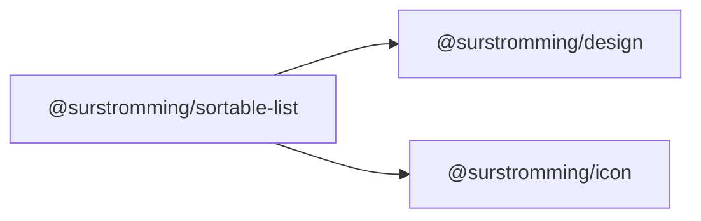

# @surstromming/sortable-list

A list whose rows are put in order by dragging them, or with the arrow keys.
Each row is a label to choose, a handle to carry it by, and a slot for what
else it needs — a delete, a count.

It is **controlled**: the list never reorders its own `items`. A row let go
somewhere new emits `move` with where it went, and the consumer puts its data
in that order — or does not, if the move is refused — and hands the items
back. What the list shows is always what the consumer holds.

## Dependency graph



## Usage

```vue
<template>
  <SortableList :items="rows" handle-label="Drag to reorder" @select="open" @move="move">
    <template #trailing="{ item }">
      <Button variant="ghost" size="icon" :aria-label="`Delete ${item.label}`" @click="remove(item.value)">
        <Icon :icon="Trash2" />
      </Button>
    </template>
  </SortableList>
</template>

<script setup lang="ts">
import { computed, ref } from 'vue'
import { Layers, Trash2 } from 'lucide'
import { SortableList, type SortableListItem } from '@surstromming/sortable-list'

const floors = ref(['Ground', 'First', 'Attic'])
const shown = ref('Ground')

const rows = computed<SortableListItem[]>(() =>
  floors.value.map((name) => ({ value: name, label: name, icon: Layers, active: name === shown.value })),
)

const open = (value: string) => (shown.value = value)

function move(value: string, to: number) {
  const next = floors.value.filter((name) => name !== value)
  next.splice(to, 0, value)
  floors.value = next
}

const remove = (value: string) => (floors.value = floors.value.filter((name) => name !== value))
</script>
```

## Props

| Prop          | Type                 | Default            | Notes                                                       |
| ------------- | -------------------- | ------------------ | ----------------------------------------------------------- |
| `items`       | `SortableListItem[]` | —                  | Required, in the order shown.                                |
| `handleLabel` | `string`             | `Drag to reorder`  | The handle's accessible name, in the app's language.         |

### Item

| Field    | Type       | Notes                                                                 |
| -------- | ---------- | --------------------------------------------------------------------- |
| `value`  | `string`   | Identity: the row's key, and what `select` and `move` emit.           |
| `label`  | `string`   | Visible text; also what the handle is described by.                   |
| `icon`   | `IconNode` | A lucide icon, beside the label.                                       |
| `active` | `boolean`  | Paints the current row. The consumer owns which one is.               |

## Emits

| Event    | Payload                      | Fired when                                                        |
| -------- | ---------------------------- | ----------------------------------------------------------------- |
| `select` | `value: string`              | A row's label is clicked.                                          |
| `move`   | `value: string, to: number`  | A row is let go at another place, or nudged by a key. `to` is its index in the new order, 0 the first. |

`move` is not emitted for a row let go where it started.

## Slots

| Slot       | Props                              | Description                                        |
| ---------- | ---------------------------------- | -------------------------------------------------- |
| `trailing` | `{ item: SortableListItem, index }` | After the label: a row's own controls.             |

## Anatomy

```
ul.root (.isSorting while a row is carried)
└─ li.row (.isActive, .isDragged)
   ├─ button.handle   the grip: carried by the pointer, nudged by the keys
   ├─ button.item     icon + label → select
   └─ <slot trailing>
```

## Behavior

- **Carried by the handle**, with a mouse, a pen or a finger: pressed, it
  captures the pointer and the row follows it up and down; the other rows
  slide aside to show where it would go; let go, `move` says where. The rest
  of a row is not a drag target, so on a touch screen it still scrolls the
  list. Escape while carrying puts the row back.
- **Rows of any height.** Every row is measured as the drag starts; the row
  goes to the place whose slot its middle is nearest, so a row of its height
  slides aside once the carried one is half way into it.
- **No jump on a drop.** The rows stay as they were dropped until the
  consumer's new `items` arrive — a frame later when the order is kept
  somewhere asynchronous — and then stand in that order with nothing to
  animate. If none arrive within half a second, the move was refused, and the
  rows go back.
- **Keys:** with the handle focused, `ArrowUp` and `ArrowDown` move the row
  one place, and focus stays with the row in its new place.
- **Reduced motion** turns the sliding off.

## Accessibility

Each handle is a button named by `handleLabel` and described by its row's
label, so a screen reader hears which row it would move. The label is a
second button, so choosing a row and carrying it are separate controls.

## Deliberately absent

- **Scrolling while carrying.** A row carried to the edge of a scrolling
  parent does not scroll it. The list is for short lists, which a dialog or a
  panel shows whole.
- **Dragging between lists**, and dropping anything that is not a row.
